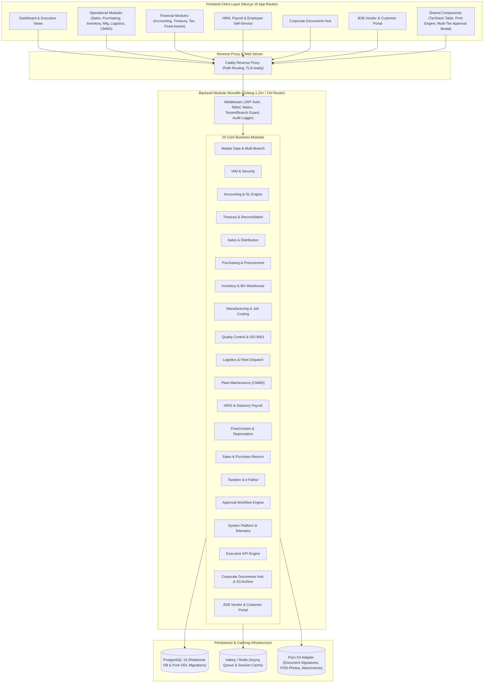
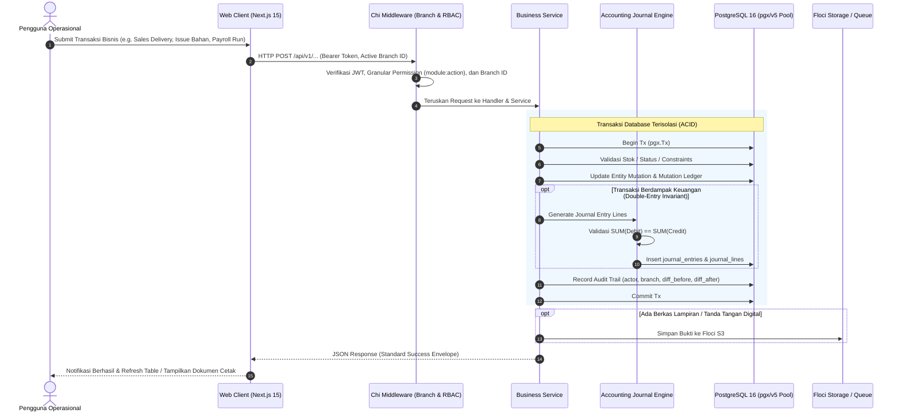

# 00. System Architecture Overview & Global Design

## 1. Ikhtisar Arsitektur Sistem

Enterprise ERP dibangun menggunakan arsitektur **Modular Monolith** dengan prinsip *Clean Architecture* di sisi Backend (Golang) dan *Next.js 15 App Router* di sisi Frontend.

---

## 2. Global Data Pipeline & Invariant Enforcement

---

## 3. Peta Modul Backend (20 Modul)

| Modul | Fokus Utama |
| :--- | :--- |
| `iam` | Autentikasi, user, role, permission matrix, user-branch mapping |
| `master` | Cabang, mata uang, UoM, tarif pajak, item, vendor, pelanggan |
| `accounting` | COA PSAK, jurnal double-entry, laporan keuangan, konsolidasi, anggaran |
| `inventory` | Stock ledger perpetual, gudang, bin, transfer, penyesuaian |
| `purchasing` | PR, RFQ, PO, GRN, vendor bill, 3-way matching |
| `sales` | Quotation, sales order, pengiriman, invoice, pembayaran, credit limit |
| `manufacturing` | BOM, routing, work order, job costing, MRP |
| `hrm` | Karyawan, presensi biometrik, cuti, lembur, payroll, ESS |
| `logistics` | Armada, trip SPJ, delivery order, proof of delivery |
| `quality` | Inspeksi QC, sertifikat CoA, NCR |
| `maintenance` | Aset mesin, preventive maintenance, work order breakdown |
| `fixedassets` | Klasifikasi aset, penyusutan, revaluasi, disposal |
| `treasury` | Rekening bank, kas kecil, transfer dana, rekonsiliasi MT940/CSV |
| `taxation` | PPN, PPh, e-Faktur, ekspor SPT |
| `returns` | RMA pelanggan, retur pembelian, debit note vendor |
| `workflow` | Approval multi-tier, threshold, riwayat persetujuan |
| `dashboard` | Ringkasan holding dan dashboard departemen |
| `system` | Audit trail, pengaturan sistem, integrasi perangkat, telemetry |
| `documents` | Tata naskah dinas, register surat, arsip S3 |
| `portal` | Portal mandiri vendor dan pelanggan B2B |

---

## 4. Batas Layanan Portal B2B

Portal bukan modul operasional internal, melainkan permukaan terbatas yang membaca data modul `purchasing`, `sales`, dan `logistics`:

- Pemetaan identitas mitra disimpan pada `portal_user_partners` dan membatasi satu user ke satu vendor atau satu pelanggan per tipe mitra.
- Vendor dapat melihat PO miliknya, mengakui atau menolak PO beserta tanggal janji kirim, dan mengirim Advance Shipping Notice (ASN).
- Pelanggan hanya dapat membaca sales order dan invoice miliknya.
- Setiap endpoint `/api/portal/*` memerlukan autentikasi dan memvalidasi `company_id` serta `branch_id` sebelum data dikembalikan.
- e-Faktur dan dokumen pajak pelanggan belum tersedia melalui portal.

