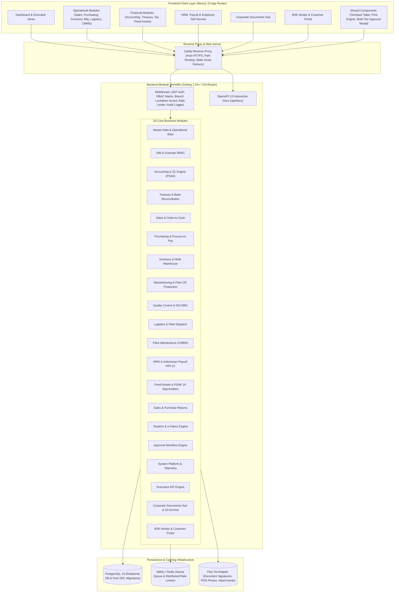
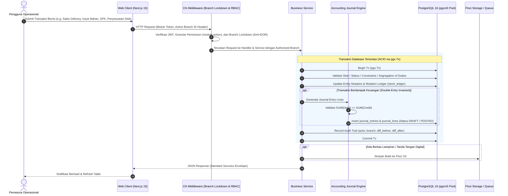

# 00. System Architecture Overview & Global Design

## 1. Ikhtisar Arsitektur Sistem

Enterprise ERP PT SAWIT JAYA (SWT) dibangun menggunakan arsitektur **Modular Monolith** dengan prinsip *Clean Architecture* di sisi Backend (Golang 1.24+) dan *Next.js 15 App Router* di sisi Frontend.

---

## 2. Tata Kelola Korporat: Perseroan Tunggal & Multi-Gudang

Sistem beroperasi berdasarkan invariant tata kelola industri:
1. **Single Corporate Legal Entity (Perseroan Tunggal)**: Seluruh transaksi bermuara pada satu entitas hukum perseroan yaitu **PT SAWIT JAYA (SWT)** dengan satu Buku Besar (General Ledger). Tidak ada akun timbal balik antar-perusahaan (*Due To/Due From*) untuk transaksi antar fasilitas internal.
2. **Operational Site Tagging (`branch_id`)**: Menandai fasilitas fisik tempat transaksi berlangsung (misalnya: Kantor Pusat & PKS-01, Pabrik Kelapa Sawit PKS-02, atau Distribution Center DC-03) untuk evaluasi performa biaya segmental (*Cost Center Accounting*).
3. **Multi-Warehouse Isolation & STO (`warehouse_id`)**: Seluruh pergerakan barang fisik tercatat pada level gudang (`warehouse_id`) melalui mutasi persediaan internal (*Stock Transfer Order* / STO).

---

## 3. Global Data Pipeline & Invariant Enforcement

---

## 4. Peta Modul Backend (20 Modul)

| Modul | Fokus Utama |
| :--- | :--- |
| `iam` | Autentikasi JWT, pengguna, peran (roles), matriks izin 21 modul × 7 aksi, penugasan cabang (`user_branches`), Segregation of Duties |
| `master` | Struktur fasilitas cabang (`branches`), mata uang, satuan (UOM), tarif pajak, item SKU, vendor, pelanggan, pusat biaya |
| `accounting` | Bagan akun PSAK, jurnal umum double-entry, buku besar, neraca saldo, budget encumbrance, konsolidasi holding (PSAK 65) |
| `inventory` | Stock ledger perpetual, gudang fisik, alokasi bin, Stock Transfer Order (STO), stock opname fisik & adjustment approval |
| `purchasing` | Purchase Requisition (PR), RFQ vendor bidding & award, Purchase Order (PO), GRN penerimaan gudang, vendor bill, 3-way matching |
| `sales` | Quotation, sales order, limit kredit pelanggan & otorisasi release, delivery order (surat jalan), konfirmasi POD, invoicing |
| `manufacturing` | BOM multi-tier, routing mesin, work centers, SPK Work Order, konsumsi bahan baku, scrap cost absorption, perhitungan MRP |
| `quality` | Inspeksi mutu IQC bahan masuk, IPQC kadar asam lemak bebas (FFA) kelapa sawit, Certificate of Analysis (CoA), Non-Conformance Report |
| `logistics` | Master armada kendaraan, penugasan supir, penerbitan Surat Perintah Jalan (SPJ), pelacakan pengiriman ekspedisi |
| `maintenance` | Register mesin industri, jadwal preventive maintenance (PM), tiket perbaikan breakdown work order, evaluasi MTBF/MTTR |
| `hrm` | Direktori karyawan, absensi geofence, pengajuan cuti & lembur (SPL), kalkulasi penggajian (payroll) tarif efektif rata-rata (TER PPh 21) |
| `fixedassets` | Register aktiva tetap, klasifikasi golongan aset, depresiasi bulanan otomatis metode garis lurus (PSAK 16), disposal aset |
| `treasury` | Rekening bank korporat, mutasi kas & bank, rekonsiliasi otomatis file bank MT940 & CSV, sistem kas kecil (petty cash imprest) |
| `taxation` | Faktur pajak keluaran/masukan, penomoran seri faktur pajak (NSFP), withholding tax PPh 23, ekspor format e-Faktur CSV DJP |
| `returns` | Return Merchandise Authorization (RMA) retur penjualan, retur barang pembelian rusak ke vendor, penerbitan Vendor Debit Note |
| `workflow` | Universal approval workflow engine, multi-tier approval berdasarkan batas nominal (threshold), pendelegasian wewenang |
| `dashboard` | Executive KPI cards, pemantauan margin segmental per cabang/pabrik, efektivitas mesin (OEE), live alerts stream (SSE) |
| `system` | Immutable audit trail viewer, telemetry kesehatan perangkat keras/timbangan pabrik, manajemen konfigurasi sistem |
| `documents` | Tata naskah dinas korporat, penomoran otomatis klasifikasi surat, brankas arsip berkas tersimpan di storage S3 |
| `portal` | Portal mandiri rekanan eksternal (B2B vendor & customer), konfirmasi pesanan, Advance Shipping Notice (ASN) |

---

## 5. Dokumentasi API Interaktif (OpenAPI 3.0)

Seluruh endpoint backend terdokumentasi secara deklaratif pada `services/api/cmd/server/openapi.yaml` dan dapat diuji secara interaktif melalui rute `/api/docs` via Swagger UI. Spesifikasi ini mencakup 193 rute API dengan skema request/response JSON terstandarisasi.
