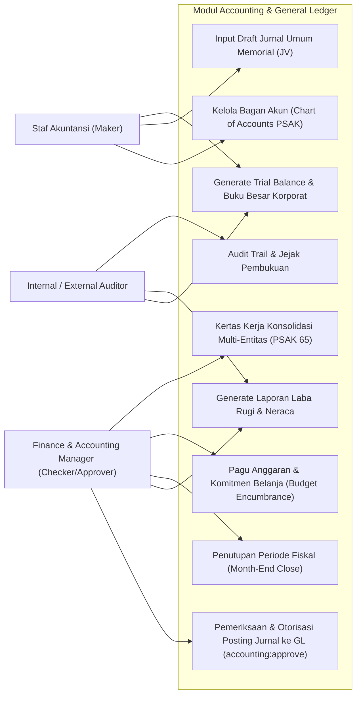
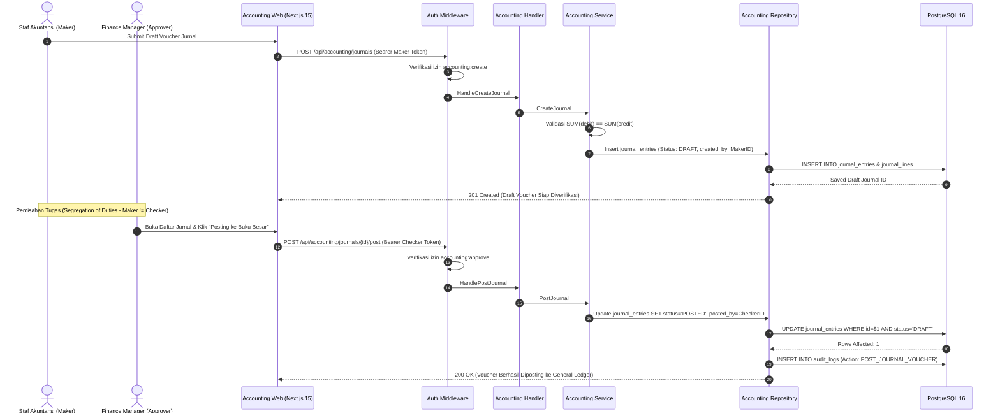
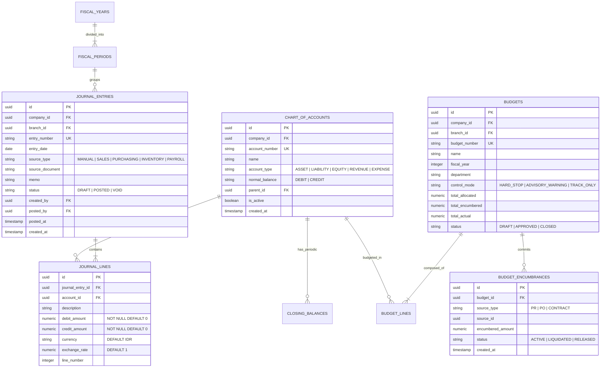

# 01. Software Design Document: Accounting & General Ledger

## 1. Ringkasan Modul & Tanggung Jawab
Modul **Accounting & General Ledger** bertanggung jawab atas pencatatan seluruh transaksi finansial PT SAWIT JAYA (SWT) dengan prinsip *Double-Entry Bookkeeping*. Setiap transaksi keuangan wajib memenuhi invarian mutlak `SUM(debit) == SUM(credit)`. Transaksi berakar pada satu Buku Besar korporat terpadu (*Single General Ledger*), dengan `branch_id` bertindak sebagai penanda segmen fasilitas fisik (*Cost Centers*).

- **Lokasi Backend**: `services/api/internal/modules/accounting/`
- **Lokasi Frontend**: `apps/web/app/(dashboard)/accounting/`

---

## 2. Use Case Diagram



---

## 3. Activity Diagram (Alur Pembuatan & Otorisasi Posting Jurnal - SoD)

```mermaid
flowchart TD
    Start([Mulai Input Voucher Jurnal]) --> InputLines[Staf Akuntansi Input Baris Debit dan Kredit]
    InputLines --> CheckBalance{Apakah SUM Debit == SUM Kredit?}
    
    CheckBalance -- Tidak --> ShowBalanceError[Tolak Transaksi: Saldo Jurnal Tidak Seimbang]
    ShowBalanceError --> InputLines
    
    CheckBalance -- Ya --> CheckPeriod{Apakah Periode Fiskal Terbuka?}
    CheckPeriod -- Terkunci/Tutup --> ShowPeriodError[Tolak: Periode Fiskal Telah Ditutup]
    ShowPeriodError --> EndFail([Selesai Gagal])
    
    CheckPeriod -- Terbuka --> SaveDraft[Simpan Jurnal Status: DRAFT]
    SaveDraft --> NotifyChecker[Notifikasi ke Finance Manager untuk Verifikasi]
    
    NotifyChecker --> ReviewAction[Finance Manager Memeriksa Dokumen Pendukung]
    ReviewAction --> CanPost{Memiliki Izin accounting:approve?}
    
    CanPost -- Tidak --> Reject403[HTTP 403 Forbidden: Pelanggaran Segregation of Duties]
    Reject403 --> EndFail
    
    CanPost -- Ya --> PostAction[Eksekusi Endpoint /journals/{id}/post]
    PostAction --> UpdateGL[Ubah Status: POSTED & Set posted_by, posted_at]
    UpdateGL --> CreateAudit[Rekam Jejak Audit Trail]
    CreateAudit --> SuccessEnd([Jurnal Berhasil Diposting ke Buku Besar])
```

---

## 4. Sequence Diagram (Siklus Pembuatan Draft & Posting Jurnal Terpisah)



---

## 5. Entity Relationship Diagram (ERD)



---

## 6. Cakupan Implementasi Terkini

- **Budget Encumbrance Engine**: Pemeriksaan ketersediaan pagu sebelum penerbitan PR dan PO. Transaksi dihentikan otomatis jika berstatus `HARD_STOP` dan pagu tidak mencukupi.
- **Konsolidasi Multi-Entitas PSAK 65 / IFRS 10**: Penyusunan laporan keuangan gabungan holding dan anak perusahaan dengan eliminasi otomatis akun transaksi timbal-balik (*intercompany elimination*).
- **Segregation of Duties Enforcement**: Staf pembukuan tidak memiliki hak posting langsung ke Buku Besar; fungsi posting diwajibkan melalui peran Manajer Keuangan (`accounting:approve`).
