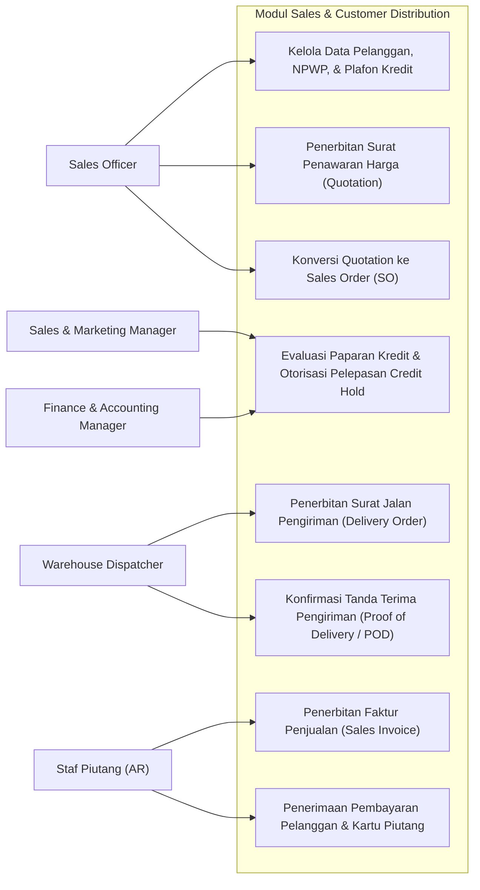
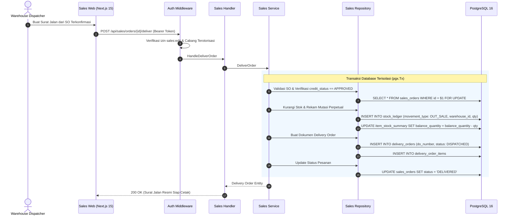
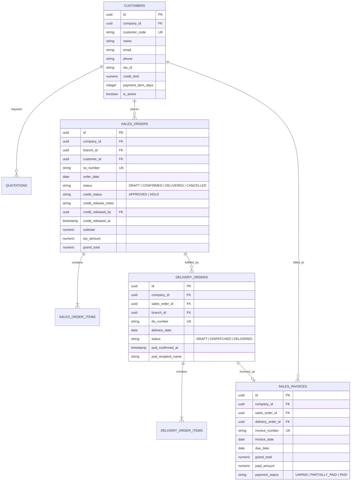

# 03. Software Design Document: Sales & Customer Distribution

## 1. Ringkasan Modul & Tanggung Jawab
Modul **Sales & Customer Distribution** mengelola siklus pendapatan (*Order-to-Cash* / O2C): Penawaran Harga Pelanggan (*Quotations*), Konfirmasi Pesanan (*Sales Orders*), Pengendalian Batas Kredit Pelanggan (*Credit Limit & Credit Hold*), Surat Jalan Pengiriman (*Delivery Orders*), Konfirmasi Serah Terima (*Proof of Delivery* / POD), Faktur Penjualan (*Sales Invoices*), dan Pelacakan Piutang Usaha (*AR Aging*).

- **Lokasi Backend**: `services/api/internal/modules/sales/`
- **Lokasi Frontend**: `apps/web/app/(dashboard)/sales/`

---

## 2. Use Case Diagram



---

## 3. Activity Diagram (Siklus Order-to-Cash & Otorisasi Credit Hold)

```mermaid
flowchart TD
    Start([Pesanan Masuk dari Pelanggan]) --> CreateSO[Sales Buat Sales Order / SO]
    CreateSO --> CheckCredit{Cek Batas Kredit: Saldo Piutang + Nilai SO > Credit Limit?}
    
    CheckCredit -- Ya: Melebihi Plafon --> HoldCredit[Set credit_status: HOLD]
    HoldCredit --> NotifyApprover[Notifikasi ke Sales Manager / Finance Manager]
    NotifyApprover --> ReviewExposure[Evaluasi Riwayat Pembayaran & Jaminan]
    
    ReviewExposure --> CanRelease{Memiliki sales:approve / accounting:approve?}
    CanRelease -- Tidak --> DenyRelease[Tolak: 403 Forbidden - Staf Sales Dilarang Override Batas Kredit]
    DenyRelease --> EndFail([Pesanan Tertahan])
    
    CanRelease -- Ya --> ExecuteRelease[Eksekusi Endpoint /orders/{id}/release-credit]
    ExecuteRelease --> SetApproved[Set credit_status: APPROVED & Catat credit_released_by]
    SetApproved --> CreateDO
    
    CheckCredit -- Tidak: Dalam Plafon --> SetApprovedNormal[credit_status: APPROVED]
    SetApprovedNormal --> CreateDO[Terbitkan Surat Jalan / Delivery Order]
    
    CreateDO --> Dispatch[Pengiriman Barang oleh Tim Logistik]
    Dispatch --> ReceivePOD[Konfirmasi Serah Terima Barang / POD]
    ReceivePOD --> GenInvoice[Generate Faktur Penjualan / Sales Invoice]
    GenInvoice --> EndDone([Siklus Penjualan Lengkap])
```

---

## 4. Sequence Diagram (Penerbitan Surat Jalan & Mutasi Stock Ledger)



---

## 5. Entity Relationship Diagram (ERD)


