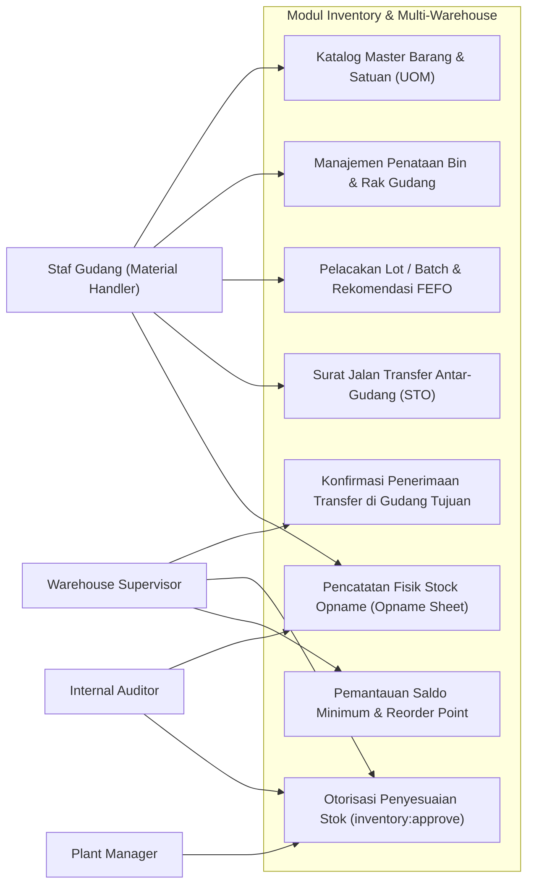
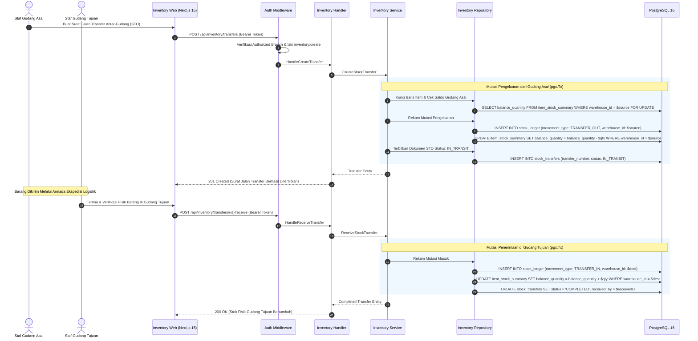
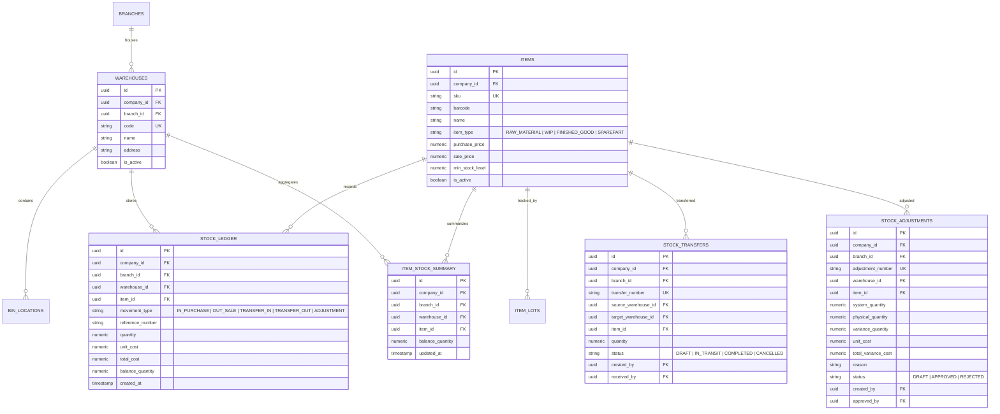

# 05. Software Design Document: Inventory & Warehouse Management

## 1. Ringkasan Modul & Tanggung Jawab
Modul **Inventory & Warehouse Management** mengelola pergerakan fisik barang dan valuasi persediaan terpadu (*Perpetual Inventory System*) pada seluruh fasilitas gudang dan pabrik PT SAWIT JAYA (SWT). Setiap mutasi stok (masuk, keluar, transfer antar-gudang, dan penyesuaian opname) mencatat transaksi permanen yang tidak dapat diubah (*immutable ledger record*) pada `stock_ledger` serta memperbarui ringkasan saldo saldo real-time pada `item_stock_summary`.

- **Lokasi Backend**: `services/api/internal/modules/inventory/`
- **Lokasi Frontend**: `apps/web/app/(dashboard)/inventory/`

---

## 2. Use Case Diagram



---

## 3. Activity Diagram (Alur Stock Opname Fisik & SoD Approval)

```mermaid
flowchart TD
    Start([Jadwal Stock Opname Berkala]) --> CountStock[Staf Gudang Menghitung Fisik Barang di Rak]
    CountStock --> CreateAdjustment[Staf Gudang Input Draft Stock Adjustment]
    CreateAdjustment --> FetchSystemQty[Sistem Mengunci Baris Item & Hitung Selisih: Fisik - Sistem]
    
    FetchSystemQty --> SaveDraft[Simpan Berita Acara Status: DRAFT]
    SaveDraft --> IsVarianceZero{Apakah Selisih Kuantitas == 0?}
    
    IsVarianceZero -- Ya: Sesuai --> AutoClose[Tutup Opname: Status COMPLETED Tanpa Jurnal]
    AutoClose --> EndDone([Selesai])
    
    IsVarianceZero -- Tidak: Ada Selisih --> RequestSpv[Eskalasi ke Warehouse Supervisor / Plant Manager]
    RequestSpv --> ReviewVariance[Supervisor Meninjau Berita Acara & Penyebab Selisih]
    
    ReviewVariance --> CanApprove{Memiliki Izin inventory:approve & Bukan Pembuat Draft?}
    CanApprove -- Tidak / Staf Gudang --> Reject403[403 Forbidden: Pelanggaran Segregation of Duties]
    Reject403 --> EndFail([Otorisasi Ditolak])
    
    CanApprove -- Ya: Supervisor Sah --> ApproveAdjustment[Eksekusi Endpoint /adjustments/{id}/approve]
    ApproveAdjustment --> WriteLedger[Catat Mutasi Penyesuaian ke stock_ledger]
    WriteLedger --> UpdateSummary[Update Saldo Akhir item_stock_summary]
    UpdateSummary --> AutoJournal[Terbitkan Jurnal Penyesuaian Persediaan ke GL]
    AutoJournal --> EndDone
```

---

## 4. Sequence Diagram (Surat Jalan Transfer Antar-Gudang / STO)



---

## 5. Entity Relationship Diagram (ERD)


