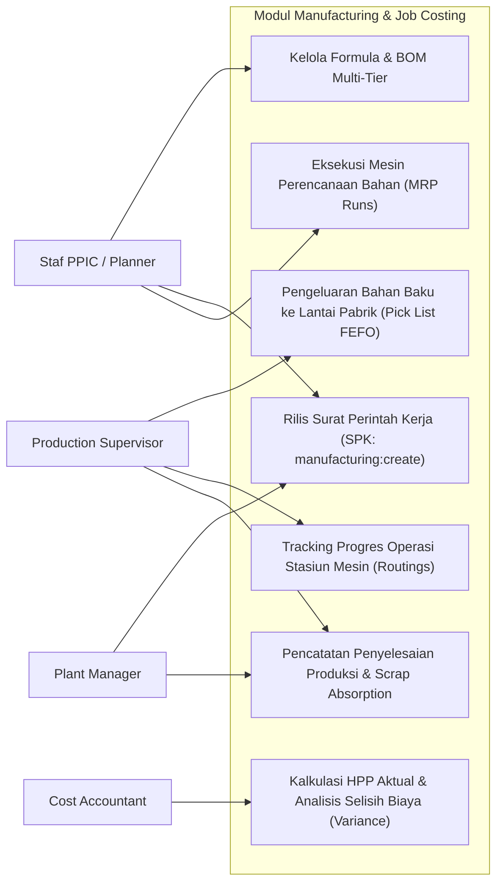
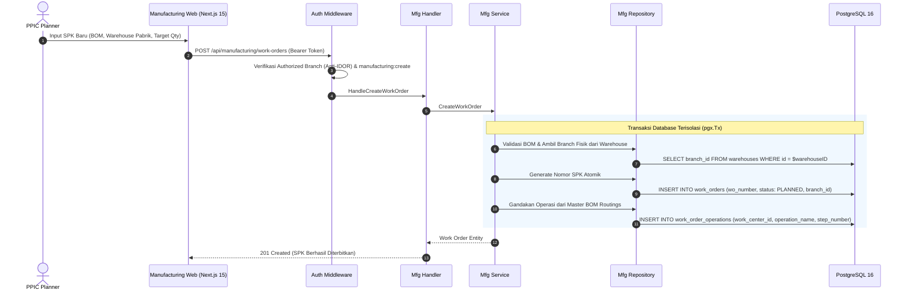
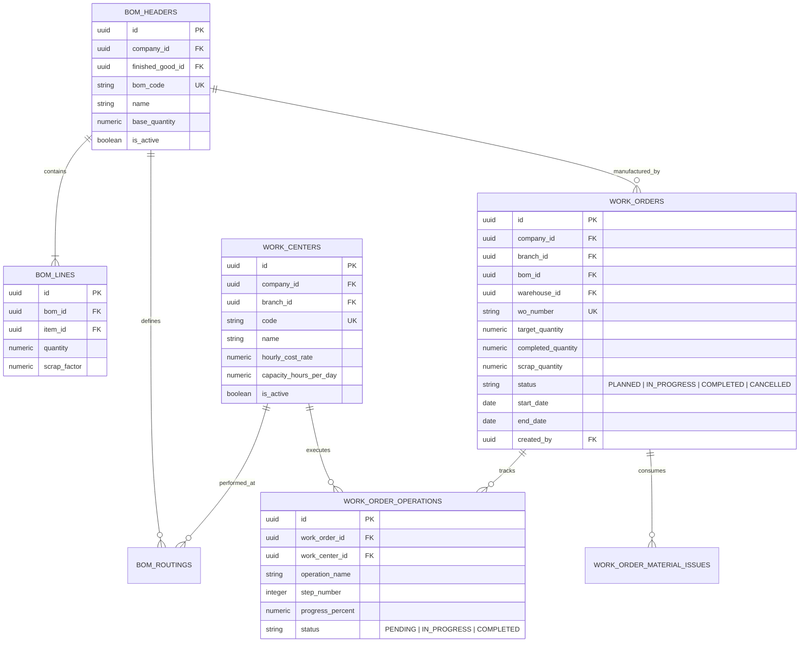

# 06. Software Design Document: Manufacturing Execution & Job Costing

## 1. Ringkasan Modul & Tanggung Jawab
Modul **Manufacturing Execution & Job Costing** mengelola alur pabrikasi kelapa sawit dan manufaktur industri PT SAWIT JAYA (SWT): Struktur Formula Bahan Baku (*Bill of Materials / BOM*), Surat Perintah Kerja (*Work Orders / SPK*), Pusat Kerja (*Work Centers*), Rute Operasi (*Routings*), Pengeluaran Bahan Baku Lantai Pabrik (*Material Issues / Pick List* FEFO), Perhitungan Perencanaan Kebutuhan Bahan (*MRP-I / MRP-II Engine*), serta Kalkulasi Biaya Pesanan Aktual (*Job Order Costing*) dengan penyerapan biaya scrap.

- **Lokasi Backend**: `services/api/internal/modules/manufacturing/`
- **Lokasi Frontend**: `apps/web/app/(dashboard)/manufacturing/`

---

## 2. Use Case Diagram



---

## 3. Activity Diagram (Siklus Eksekusi SPK, Otorisasi Branch, & Penyelesaian Produksi)

```mermaid
flowchart TD
    Start([Perencanaan Batch Pabrikasi]) --> CreateSPK[Staf Buat SPK Work Order]
    CreateSPK --> BindBranch[Sistem Enforce Authorized Branch & Warehouse Pabrik]
    BindBranch --> GenerateDocNo[Generate Nomor SPK Unik SPK/YYYY/MM/...]
    
    GenerateDocNo --> AutoRoutings[Salin Rute Stasiun Kerja dari BOM ke SPK Operations]
    AutoRoutings --> IssueMaterials[Terbitkan Pick List Bahan Baku Lot FEFO]
    
    IssueMaterials --> ProcessFloor[Eksekusi Produksi di Lantai Pabrik & Rekam Jam Kerja]
    ProcessFloor --> InspectQC[Inspeksi Mutu IPQC Kadar Asam Lemak Bebas / FFA]
    
    InspectQC --> CompleteOrder[Supervisor Panggil /work-orders/{id}/complete]
    CompleteOrder --> DeductComponents[Konsumsi Otomatis Bahan Baku dari stock_ledger]
    DeductComponents --> AbsorbScrap[Serap Biaya Scrap ke Nilai HPP Barang Jadi]
    DeductComponents --> IncreaseFG[Tambah Stok Barang Jadi pada Gudang Tujuan]
    
    IncreaseFG --> CalculateJobCost[Kalkulasi HPP Aktual: Material + Tenaga Kerja + Overhead]
    CalculateJobCost --> AutoGL[Auto-Posting Jurnal Pemindahan WIP ke Persediaan Barang Jadi]
    AutoGL --> EndDone([Produksi Batch Selesai])
```

---

## 4. Sequence Diagram (Penerbitan SPK & Pengikatan Fasilitas Pabrik)



---

## 5. Entity Relationship Diagram (ERD)


