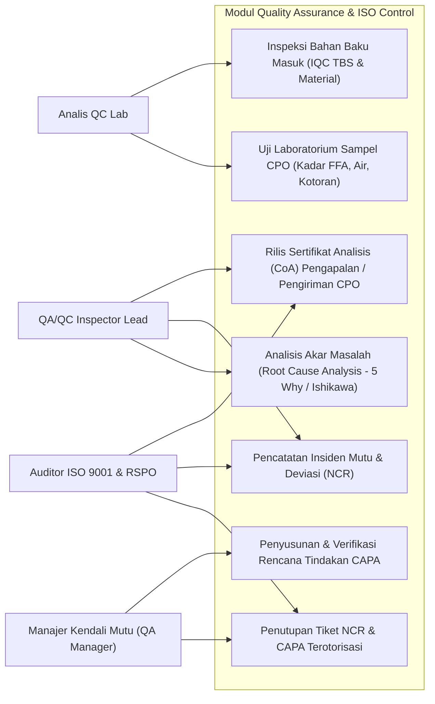
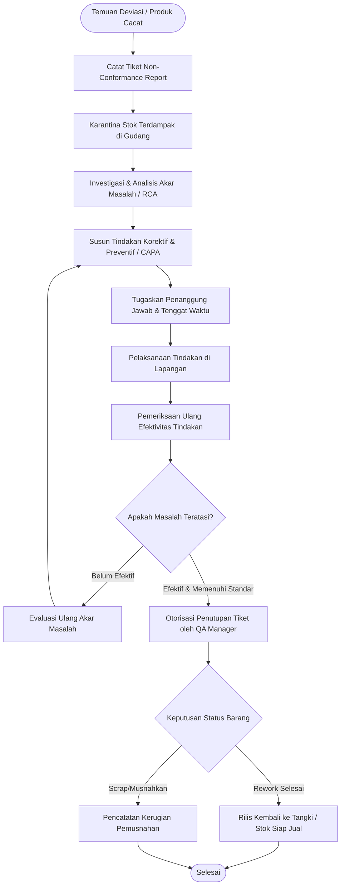
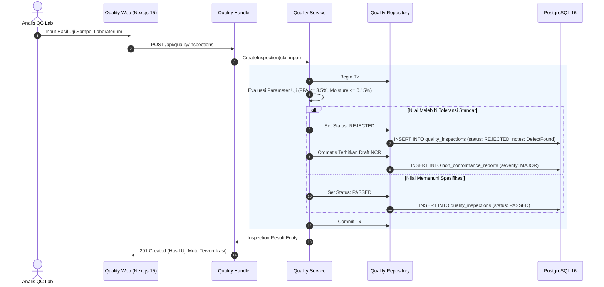
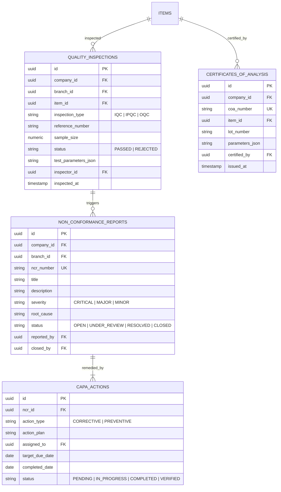

# 07. Software Design Document: Quality Assurance & ISO Control

## 1. Ringkasan Modul & Tanggung Jawab
Modul **Quality Assurance & Control** mengelola standar mutu ISO 9001:2015 serta standar mutu industri pengolahan kelapa sawit PT SAWIT JAYA (SWT): Inspeksi Bahan Baku Masuk (*Incoming Quality Control / IQC* seperti Tandan Buah Segar / TBS), Inspeksi Proses Pabrikasi (*In-Process Quality Control / IPQC* kadar FFA, moisture, dan impurities), Penerbitan Sertifikat Analisis Laboratorium (*Certificate of Analysis / CoA* Crude Palm Oil - CPO & Palm Kernel), serta Pelaporan Ketidaksesuaian Mutu (*Non-Conformance Report / NCR*) dan Siklus Tindakan Korektif-Preventif (*CAPA 8D*).

- **Lokasi Backend**: `services/api/internal/modules/quality/`
- **Lokasi Frontend**: `apps/web/app/(dashboard)/quality/`

---

## 2. Use Case Diagram

---

## 3. Activity Diagram (Siklus Penanganan Ketidaksesuaian Mutu NCR / CAPA)

---

## 4. Sequence Diagram (Inspeksi Masuk IQC & Penolakan Mutu)

---

## 5. Entity Relationship Diagram (ERD)

---

## 6. Cakupan Implementasi Terkini

- **Inspeksi IPQC Kelapa Sawit**: Pengujian sampel berkala pada tangki klarifikasi dan stasiun pengempaan untuk memastikan kadar asam lemak bebas (FFA) minyak sawit mentah (CPO) berada di bawah ambang batas legal ekspor (maksimal 3% s.d 5%).
- **Digital Certificate of Analysis (CoA)**: Format cetak resmi CoA berstandar industri ekspor dilengkapi kode verifikasi hash untuk pengapalan tangki CPO.
- **Integrasi dengan Modul Purchasing**: Kegagalan inspeksi bahan masuk (IQC) secara otomatis memicu opsi penerbitan Vendor Debit Note dan klaim penalti rafaksi harga tandan buah sawit.
