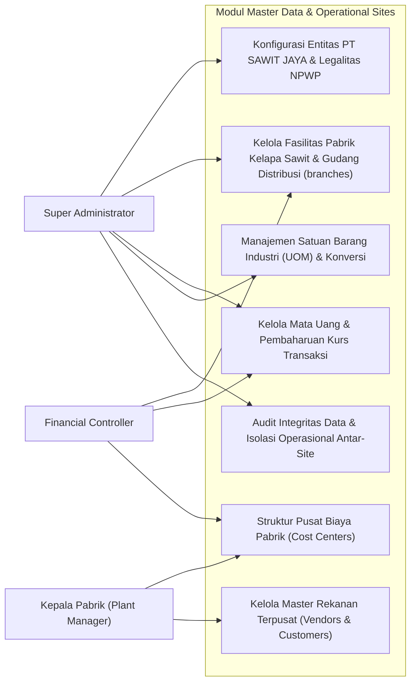
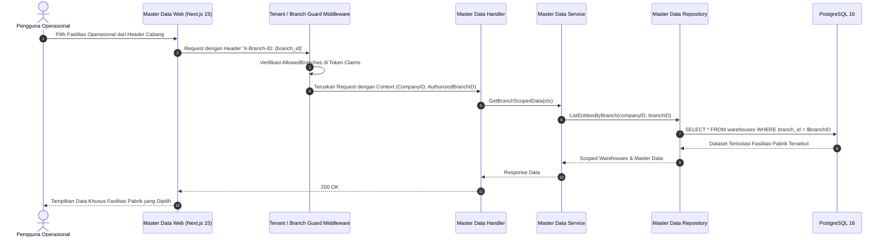
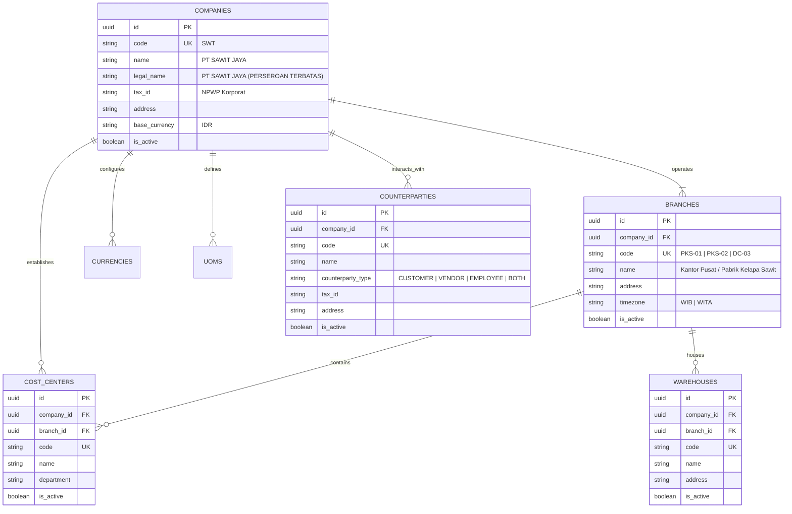

# 15. Software Design Document: Master Data & Operational Site Governance

## 1. Ringkasan Modul & Tanggung Jawab
Modul **Master Data & Operational Site Governance** mengelola fondasi organisasi korporasi industri PT SAWIT JAYA (SWT): Struktur Entitas Perseroan Tunggal (*Single Corporate Legal Entity*), Fasilitas Fisik Operasional Pabrik & Distribusi (*Operational Sites / Branches*), Mata Uang & Kurs (*Currencies & Exchange Rates*), Satuan Pengukuran (*UOM & Konversi*), Pusat Biaya (*Cost Centers*), serta Database Rekanan Mitra Bisnis Terpadu (*Counterparties*).

- **Lokasi Backend**: `services/api/internal/modules/master/`
- **Lokasi Frontend**: `apps/web/app/(dashboard)/master-data/`

---

## 2. Use Case Diagram



---

## 3. Activity Diagram (Tata Kelola Fasilitas Fisik & Isolasi Operasional)

```mermaid
flowchart TD
    Start([Pengguna Mengakses Sistem]) --> AuthToken[Validasi Sesi Pengguna & Token JWT]
    AuthToken --> FetchBranches[Ambil Daftar Cabang yang Diizinkan dari user_branches]
    
    FetchBranches --> SelectBranch{Pilih Site Operasional (activeBranchId)}
    SelectBranch --> IsSuperAdmin{Super Admin / Direksi?}
    
    IsSuperAdmin -- Ya --> AllowConsolidated[Dapat Memilih Semua Cabang atau Konsolidasi Nasional]
    IsSuperAdmin -- Tidak --> EnforceScoped[Wajib Terkunci pada Site Penugasan Resmi Pengguna]
    
    AllowConsolidated --> SetContext[Sematkan Konteks: Company ID & Authorized Branch ID]
    EnforceScoped --> SetContext
    
    SetContext --> ExecQuery[Jalankan Transaksi / Kueri Data]
    ExecQuery --> FilterBranch[Tambahkan Filter Otomatis: WHERE branch_id = activeBranchId]
    
    FilterBranch --> IsInterSiteTransfer{Pergerakan Barang Antar-Site?}
    IsInterSiteTransfer -- Tidak --> CommitLocal[Simpan Data Mutasi Site Lokal]
    
    IsInterSiteTransfer -- Ya --> STOFlow[Bentuk Stock Transfer Order / STO Antar-Gudang Fisik]
    STOFlow --> CommitLocal
    
    CommitLocal --> EndDone([Kueri Terisolasi & Sesuai Governance])
```

---

## 4. Sequence Diagram (Pengalihan Konteks Cabang & Isolasi Kueri)



---

## 5. Entity Relationship Diagram (ERD)


