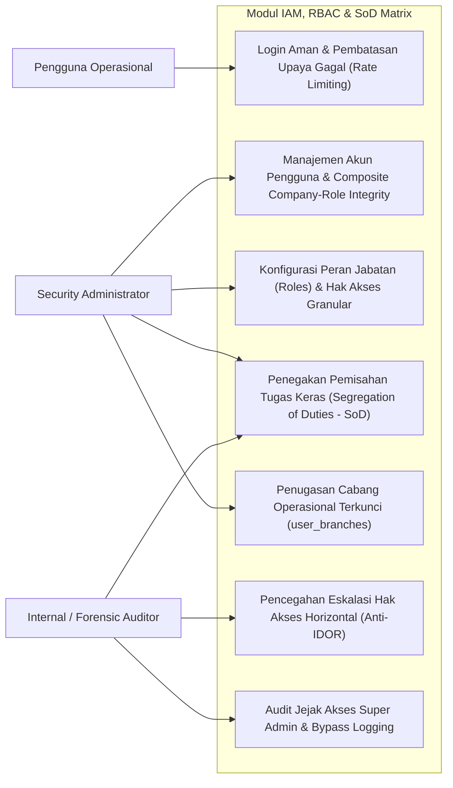
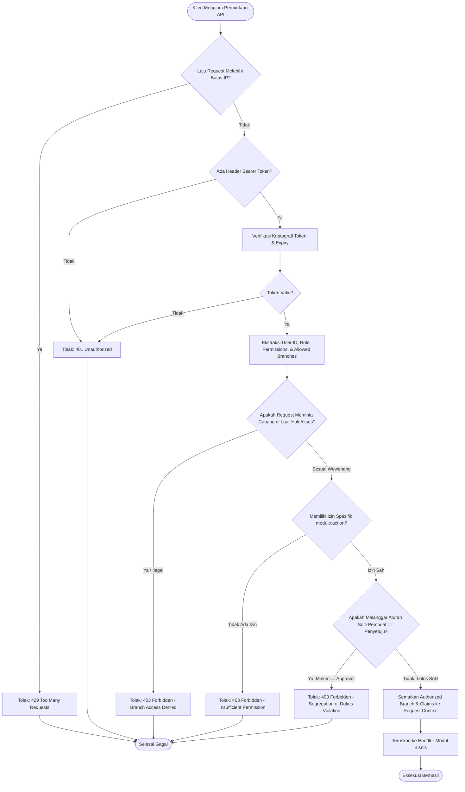
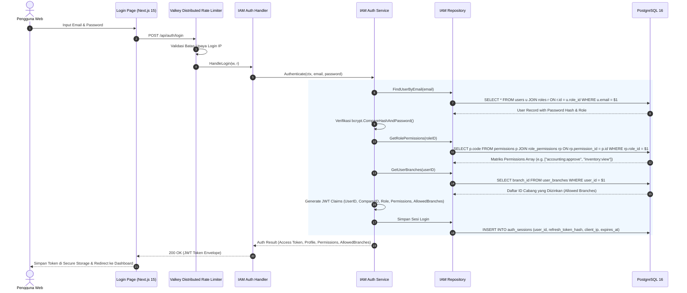
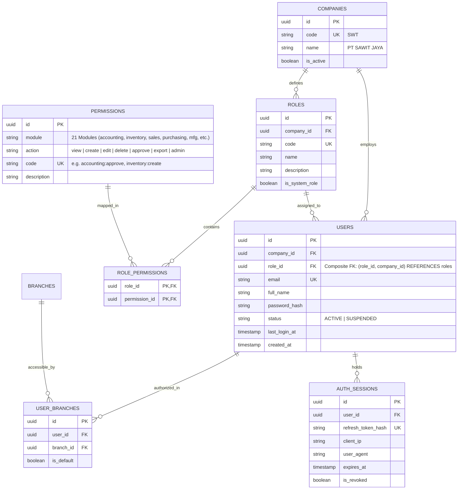

# 16. Software Design Document: IAM, Granular RBAC & Segregation of Duties (SoD)

## 1. Ringkasan Modul & Tanggung Jawab
Modul **Identity & Access Management (IAM), Granular RBAC & Segregation of Duties (SoD)** bertanggung jawab atas integritas keamanan akses sistem PT SAWIT JAYA (SWT): Otentikasi Berbasis JWT (*JSON Web Tokens*), Hashing Kata Sandi (*bcrypt*), Penegakan Matriks Izin Granular 21 Modul × 7 Aksi (`module:action`), Isolasi Akses Fasilitas Cabang (*Horizontal Branch Isolation / Anti-IDOR*), Penegakan Pemisahan Tugas (*Segregation of Duties / Maker-Checker Rules*), dan Pembatasan Laju Kueri Terdistribusi (*Distributed Rate Limiting via Valkey*).

- **Lokasi Backend**: `services/api/internal/modules/iam/` & `services/api/internal/platform/middleware/`
- **Lokasi Frontend**: `apps/web/app/(auth)/login/` & `apps/web/app/(dashboard)/settings/iam/`

---

## 2. Use Case Diagram

---

## 3. Activity Diagram (Otentikasi JWT, Anti-IDOR Branch Guard, & Verifikasi SoD)

---

## 4. Sequence Diagram (Alur Login & Pembuatan Token Sesi Terisolasi)

---

## 5. Entity Relationship Diagram (ERD)

---

## 6. Matriks Pemisahan Tugas (Segregation of Duties - SoD)

Untuk mencegah kecurangan dan konflik kepentingan (*fraud & ghost transactions*), sistem menegakkan aturan SoD keras (*HARD SoD Rules*):

| Modul | Tindakan Maker (Pembuat) | Tindakan Approver (Penyetuju) | Tingkat Konflik | Risiko yang Dicegah |
|---|---|---|---|---|
| **Accounting** | `accounting:create` (Buat Jurnal Memorial) | `accounting:approve` (Posting ke Buku Besar) | **HARD** | Pembuatan dan posting voucher jurnal fiktif tanpa pengawasan manajer keuangan. |
| **Inventory** | `inventory:create` (Input Opname Fisik) | `inventory:approve` (Approve Selisih Stok) | **HARD** | Staf gudang menutupi kehilangan fisik barang dengan menyetujui stock adjustment sendiri. |
| **Purchasing** | `purchasing:create` (Buat PO / Submit Bid) | `purchasing:approve` (Approve PO / Award RFQ) | **HARD** | Pembelian fiktif atau penetapan pemenang tender tanpa otorisasi pimpinan pengadaan. |
| **Purchasing / AP** | `accounting:create` / `accounting:edit` (Catat Faktur) | `purchasing:approve` / `accounting:approve` (Approve Tagihan) | **HARD** | Staf pencatat invoice vendor meloloskan pembayaran fiktif tanpa verifikasi 3-Way Match. |
| **Sales** | `sales:create` / `sales:edit` (Buat Sales Order) | `sales:approve` / `accounting:approve` (Release Credit Hold) | **HARD** | Staf sales lapangan melepaskan pesanan pelanggan macet yang melebihi batas plafon kredit. |
