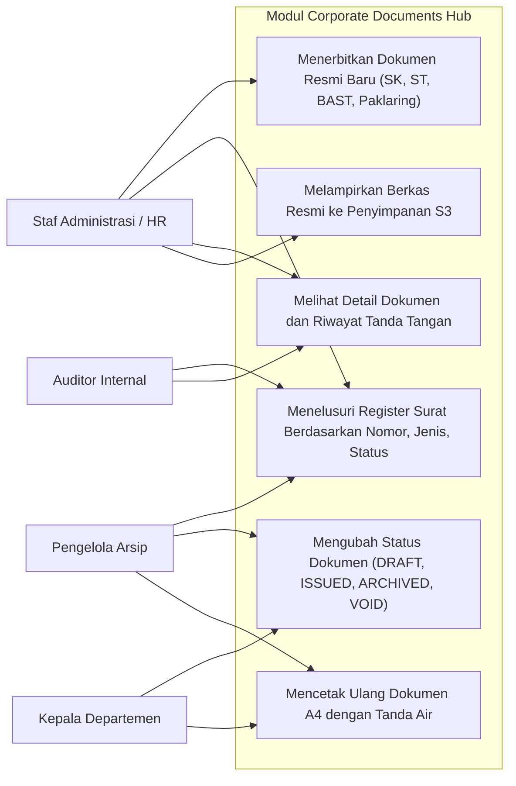
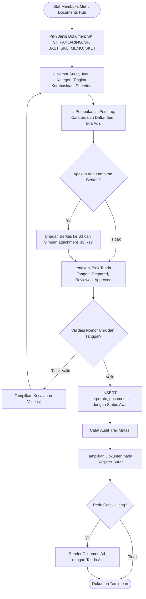
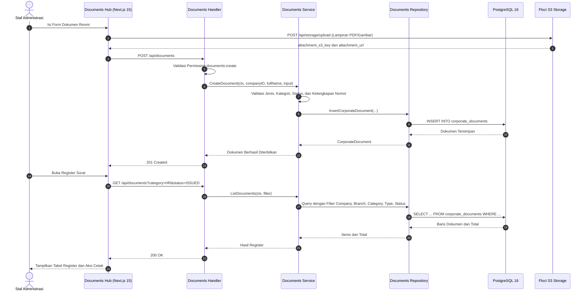
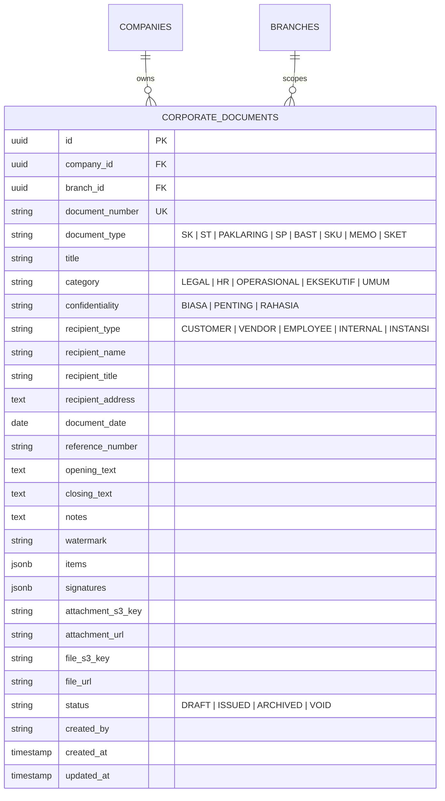

# 19. Software Design Document: Corporate Documents Hub

## 1. Ringkasan Modul & Tanggung Jawab
Modul **Corporate Documents Hub** mengelola tata naskah dinas dan surat keputusan administratif perusahaan: penerbitan dokumen resmi, penomoran surat, register agenda keluar, penandatanganan berjenjang, tanda air (*watermark*), serta pengarsipan berkas digital ke penyimpanan S3-compatible. Dokumen komersial dan transaksional seperti PO, SO, delivery order, SPK, dan invoice tetap berada di modul bisnis masing-masing.

- **Lokasi Backend**: `services/api/internal/modules/documents/`
- **Lokasi Frontend**: `apps/web/app/(dashboard)/documents/`
- **Tabel Utama**: `corporate_documents`
- **Endpoint**: `GET /api/documents`, `GET /api/documents/{id}`, `POST /api/documents`, `PATCH /api/documents/{id}/status`
- **Permission**: `documents:view`, `documents:create`, `documents:edit`

Jenis dokumen yang didukung: `SK`, `ST`, `PAKLARING`, `SP`, `BAST`, `SKU`, `MEMO`, `SKET`.
Kategori: `LEGAL`, `HR`, `OPERASIONAL`, `EKSEKUTIF`, `UMUM`.
Status: `DRAFT`, `ISSUED`, `ARCHIVED`, `VOID`.

---

## 2. Use Case Diagram

---

## 3. Activity Diagram (Penerbitan dan Pengarsipan Dokumen Resmi)

---

## 4. Sequence Diagram (Penerbitan Dokumen dan Pengambilan Daftar Register)

---

## 5. Entity Relationship Diagram (ERD)

Catatan integritas:
- Kombinasi `company_id` dan `document_number` bersifat unik.
- `branch_id` bersifat opsional untuk dokumen tingkat perusahaan.
- `items` dan `signatures` disimpan sebagai JSONB agar struktur dokumen fleksibel tanpa mengubah skema.
- Berkas lampiran disimpan di object storage dan hanya kunci S3 yang dicatat pada database.
