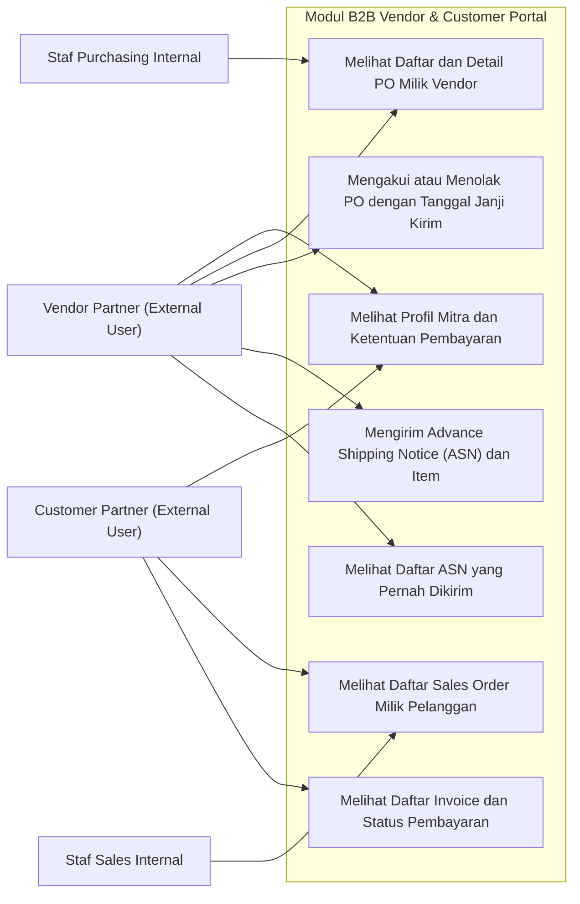
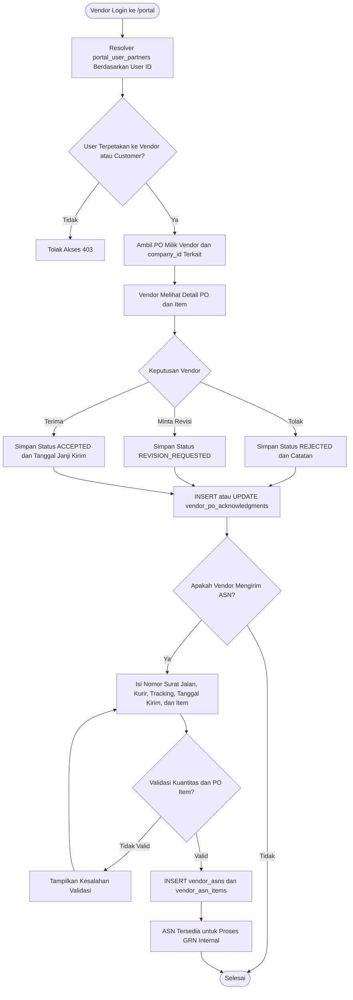
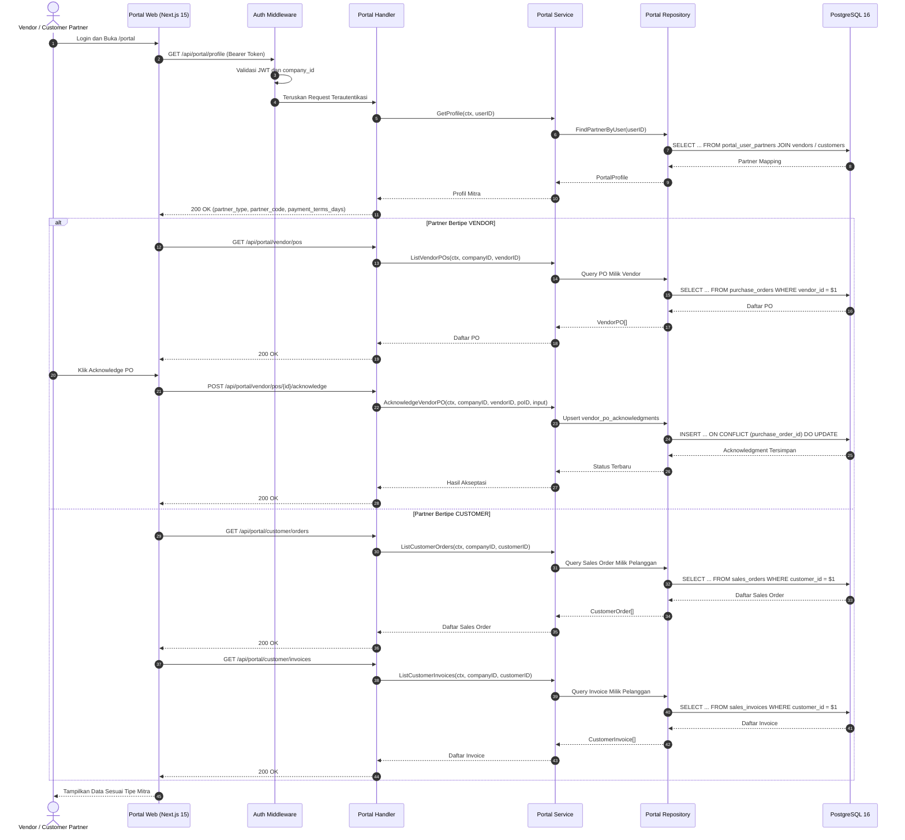
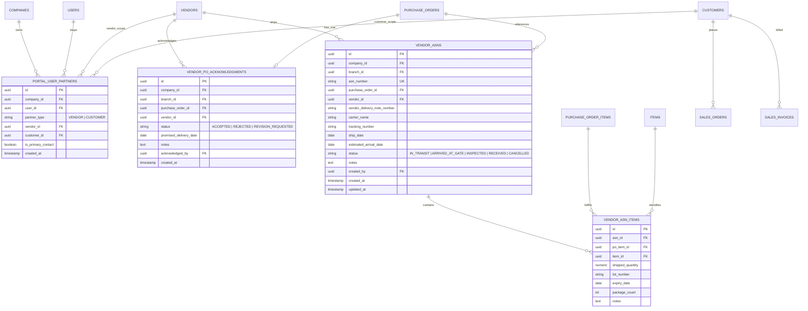

# 20. Software Design Document: B2B Vendor & Customer Portal

## 1. Ringkasan Modul & Tanggung Jawab
Modul **B2B Vendor & Customer Portal** menyediakan akses mandiri terbatas bagi mitra eksternal. Vendor dapat melihat purchase order miliknya, mengakui atau menolak PO beserta tanggal janji kirim, dan mengirim Advance Shipping Notice (ASN). Pelanggan dapat melihat sales order dan invoice miliknya dalam mode baca. Portal tidak membuka data internal lintas mitra dan tidak menggantikan modul operasional internal.

- **Lokasi Backend**: `services/api/internal/modules/portal/`
- **Lokasi Frontend**: `apps/web/app/(dashboard)/portal/`
- **Tabel Utama**: `portal_user_partners`, `vendor_po_acknowledgments`, `vendor_asns`, `vendor_asn_items`
- **Endpoint**:
  - `GET /api/portal/profile`
  - `GET /api/portal/vendor/pos`
  - `GET /api/portal/vendor/pos/{id}`
  - `POST /api/portal/vendor/pos/{id}/acknowledge`
  - `GET /api/portal/vendor/asns`
  - `POST /api/portal/vendor/asns`
  - `GET /api/portal/customer/orders`
  - `GET /api/portal/customer/invoices`
- **Akun Demo**: `vendor.krakatau@erp.local` dan `customer.astra@erp.local` dengan password `DemoPassword2026!`

Status acknowledgment PO: `ACCEPTED`, `REJECTED`, `REVISION_REQUESTED`.
Status ASN: `IN_TRANSIT`, `ARRIVED_AT_GATE`, `INSPECTED`, `RECEIVED`, `CANCELLED`.

---

## 2. Use Case Diagram

---

## 3. Activity Diagram (Akseptasi PO dan Pengiriman ASN oleh Vendor)

---

## 4. Sequence Diagram (Permintaan Data Portal Vendor dan Pelanggan)

---

## 5. Entity Relationship Diagram (ERD)

Catatan integritas dan keamanan:
- `portal_user_partners` memiliki constraint unik `(user_id, partner_type)` dan check constraint yang memastikan tepat satu dari `vendor_id` atau `customer_id` terisi.
- Setiap endpoint portal memerlukan autentikasi dan memvalidasi kepemilikan data berdasarkan pemetaan mitra, `company_id`, dan `branch_id`.
- Vendor tidak dapat mengakses PO vendor lain, dan pelanggan tidak dapat mengakses pesanan atau tagihan pelanggan lain.
- e-Faktur dan dokumen pajak pelanggan belum diekspos melalui portal.
